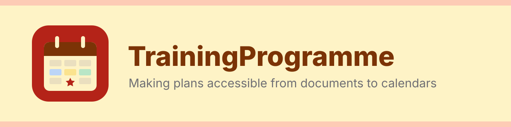

<p align="center">
  
</p>

<p align="center">
  <a href="https://github.com/choonyongchan/BattalionTrainingProgramme/actions/workflows/ci.yml"></a>
  <a href="https://codecov.io/gh/choonyongchan/BattalionTrainingProgramme"></a>
</p>

# User Guide

This app keeps each company's weekly training programme in one place and in step with Google
Calendar. You upload the programme. The app reads it into a timetable that matches
the paper grid, you check it, and it goes to every company's Google Calendar. After that, a change
in either place shows up in the other.

## Signing in

1. Open the app. You land on the sign-in page.
2. Type the **access key** your training clerk gave you, then press **Sign in**.
3. The browser stays signed in for 30 days (an admin can change this). Don't sign in on a shared computer.

If the key is refused, check it with your clerk. Keys can be changed, and changing one signs everyone out.

Press **Sign out** at the top right when you're done. If a device or the key may have leaked, an admin can sign
every browser out at once (see Settings).

## Reading the programme

The **Programme** page opens on this week.

- **Rows are days and columns are training periods** (0–10, Night Trg 1–3, Overnight), with
  **Remarks** on the right, just like the paper programme. Today's row is tinted.
- Each block shows the activity, then the conducting officer (COND), location (LOC) and resources
  (RESRC). Its colour is the category; the legend is under the timetable.
- If a block was moved to a time that isn't on the period grid, its exact times are shown on it.
- **Company buttons** (All, Archer, Braves, …) show one company's programme. Under **All**, each
  block shows which companies it belongs to.
- **‹ ›** move a week back or forward. **This week** jumps back to today.
- Under the timetable, each company has a list of its activities for the week.
- **Upcoming** switches to a table of everything in the next 60 days.

### Searching

Type in the search box at the top. Both the timetable and the Upcoming table filter as you type.

| You type | You get |
|---|---|
| `live firing` | Activities containing both words |
| `range OR ippt` | Either word |
| `NOT co:braves` | Everything except Braves |
| `cat:"live firing" OR (range AND NOT co:braves)` | Combinations; brackets group |

Search one field with `cat:` (category), `loc:` (location), `cond:` (conducting), `resrc:`
(resources), `co:` (company) or `title:`. Plain words search the title, category and comments.
`AND`, `OR` and `NOT` must be in capitals. Press **?** in the search box for a reminder. If the
search can't be read, a red message under the box says why.

## Changing an activity

- **Add one:** press **New activity**, fill it in, tick its companies and press **Save**. It starts
  today (or on the Monday of the week shown) and is ticked for the company tab you are on.
- **Move it:** drag a block to another day or period. It keeps its length.
- **Edit it:** click a block to change its title, date, periods, companies, category, COND, LOC,
  RESRC or comments. Press **Save**.
- **Make it a remark:** tick **Remarks (all day)**. Use **Until** for remarks that span several days.
- **Delete it:** open it and press **Delete**. It is removed from every company's calendar.

Every change goes straight to Google Calendar.

### When Google Calendar changes too

Each time you open the page or press **Sync with Google**, the app picks up changes made in Google
Calendar. If someone changed the same activity in Google Calendar while you were editing it,
**Google Calendar wins**. The app tells you and shows the latest version, so check it and edit again if needed.

## Information security

Uploaded programmes are sent to third-party services: **OpenAI** reads the file, and **Google Calendar**
stores the resulting activities. Only upload a programme **within security classification requirements**,
meaning it is cleared for processing and storage on those services under your unit's policy.

- The Upload page asks you to confirm this before it accepts any file. The confirmation is your declaration
  that you checked the programme's classification and have authority to upload it.
- If you are unsure, do not upload. Ask your security officer or training clerk first.
- Don't put anything in the programme or its comments that your unit's policy doesn't allow on these services.

## Uploading a new programme

1. Go to **Upload**.
2. Optional: pick the company. Otherwise the app reads it from the programme's heading.
3. Tick the **security confirmation** (see below), press **Choose files**, and pick one or more images or a PDF. Several companies at once is fine.
4. Wait while each file is read. This can take a minute or two.
5. **Review the draft.** It is shown as a timetable. Blocks with an **orange outline** are ones the
   AI wasn't sure about, and the reason is in the comments. Click a block to fix it, or drag it to move it.
   Press **New activity** to add anything the AI missed.
6. Press **Add N activities to Google Calendar**.

Good to know:

- Uploading the same week again doesn't create duplicates. Only new activities are added.
- If the same activity happens at the same time and place for several companies, it becomes one
  block tagged with all of them.
- If the company can't be read from the page, you are asked to pick it and try again. If the heading is
  cut off, the AI may work it out from the commander (e.g. "B COMD") and outline that block in orange.
- A strip across the whole day (e.g. "DRIVING TRADES (HUNTER)") becomes a remark. An activity for only part
  of the company (one lane, a sub-unit row, or a thin strip over a block) becomes its own block, and its
  comments say who it is for. Two activities stacked in one cell become two blocks.
- Red text on the paper programme is treated as tentative and outlined in orange.

> **Check the result.** The AI reads an uploaded document. Times, names and locations
> can occasionally be misread. Compare anything odd against the original programme.

## Settings (admins)

Anyone signed in can see **Settings**. To change them, type the **admin key** and press
**Unlock editing**. Editing stays unlocked for an hour. Press **Save settings** when you're done;
**Discard changes** undoes unsaved edits, and **Restore defaults** brings back the factory setup (until you save).

| Section | What you can change |
|---|---|
| **Unit** | Unit name (shown everywhere), the calendar naming pattern, and the Google account that owns new calendars |
| **Companies** | Add, remove, rename and reorder companies, and pick each company's colour. A new company gets its own Google Calendar on the next sync. Renaming a company starts a new calendar |
| **Categories** | Names, colours in the app, colours in Google Calendar, and the cell colour on the paper programme (the AI uses this to recognise the category) |
| **Periods** | The timetable columns: key, label, start and end. They must be in time order and must not overlap. Existing activities snap to the nearest period |
| **Behaviour** | AI model and effort, how far the Upcoming list looks ahead, how long past activities are kept, image size for uploads, and how long sign-in lasts |
| **Sign-ins** | **Sign everyone out** ends every browser's sign-in, yours included. Everyone signs in again with the access key |
| **Keys and passwords** | The access key, OpenAI API key and Google service account key. They are stored encrypted and never shown again; the page only says where each comes from. **Clear** falls back to the server's own setting |

If something is wrong (for example, two companies with the same name or overlapping periods), the
save is refused with a message saying what to fix.

## Troubleshooting

| You see | Do this |
|---|---|
| "Google Calendar sync failed: …" | The programme shown is the last saved copy. Press **Sync with Google** again later; if it keeps failing, ask an admin to check the Google key in Settings |
| "… was changed in Google Calendar — showing the latest version" | Someone edited it in Google at the same time. Check the block and edit again |
| "Couldn't tell which company this is" | Pick the company on the Upload page and upload again |
| "Couldn't read …: No OpenAI API key" | An admin needs to set the OpenAI key in Settings |
| "Editing is off until ADMIN_KEY is set on the server" | The developer needs to set `ADMIN_KEY` (see the developer guide) |

---

**Developers:** [Developer guide](docs/developer-guide.md) · [Architecture](docs/architecture_patterns.md) · [Design](DESIGN.md)

```
bun install
cp frontend/.env.example frontend/.env.local   # fill it in
bun run db:migrate                             # create the tables
bun run dev
bun run test            # unit + integration + e2e
bun run test:coverage   # unit + integration, writes coverage/lcov.info
```
